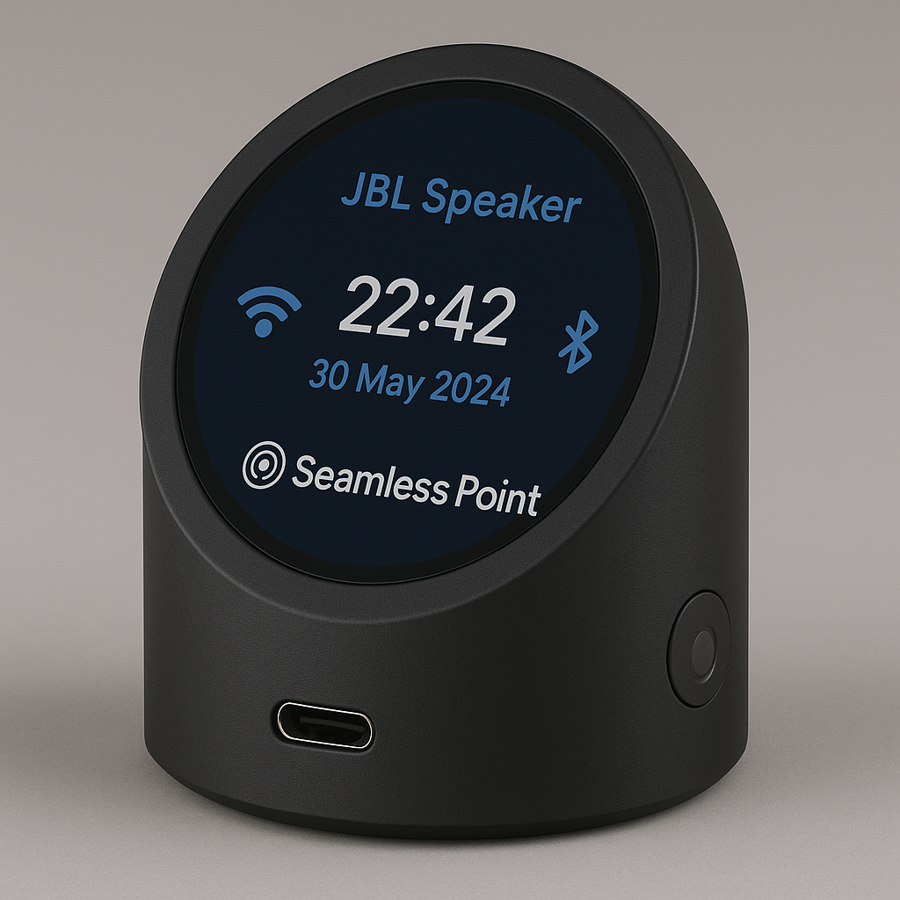

**The Universal Audio Hub for Music, Media & Gaming**

Seamless Point is a modern, minimalist audio device that seamlessly connects all your sound sources and outputs—whether you're listening to music, watching movies, or diving into high-performance PC gaming. Compatible with AirPlay, USB audio, and wireless speakers, it acts as a smart audio bridge between your devices and your environment.

Designed for gamers and audiophiles alike, Seamless Point doubles as a **dedicated PC gaming audio station**, offering ultra-low latency sound routing, crystal-clear output, and flexible device switching. Whether you're using USB headphones, studio monitors, or Bluetooth headsets, Seamless Point keeps everything in sync—so your experience is uninterrupted, immersive, and effortless.

From everyday listening to competitive gameplay, Seamless Point brings all your audio together into one intelligent, elegant system.

Guides for building and managing seamless point yocto image.

Hardware render
-----------------


Build yocto image (native, Ubuntu)
----------------------------------

Tested on Ubuntu 22.04/24.04. BitBake must not be run as root.

0. Point an environment variable at the project root (optional, used below):
  ```bash
  echo 'export sp="$HOME/Documents/seamless-point"' >> ~/.bashrc
  source ~/.bashrc
  ```

1. Install the Yocto host dependencies:
  ```bash
  sudo apt-get update && sudo apt-get install -y \
    gawk wget git diffstat unzip texinfo gcc build-essential chrpath socat \
    cpio python3 python3-pip python3-pexpect xz-utils debianutils \
    iputils-ping python3-git python3-jinja2 python3-subunit zstd liblz4-tool \
    file locales libacl1 bzip2 rsync kmod
  ```

2. Ensure a UTF-8 locale (BitBake aborts without one):
  ```bash
  sudo locale-gen en_US.UTF-8
  export LANG=en_US.UTF-8 LC_ALL=en_US.UTF-8
  ```

3. On Ubuntu 23.10+ only, allow unprivileged user namespaces (needed by
   BitBake's pseudo/sandboxing):
  ```bash
  sudo sysctl -w kernel.apparmor_restrict_unprivileged_userns=0
  ```

4. Sync the project (skip if already synced):
  ```bash
  mkdir -p "$sp" && cd "$sp"
  repo init -u git@github.com:kuzhylol/seamless-point-manifest.git -b scarthgap
  repo sync -j"$(nproc)"
  ```

5. Initialise the Yocto build environment (creates "$sp/build"):
  ```bash
  TEMPLATECONF="$sp/meta-seamless-point/conf/templates/sp-main" \
    source "$sp/poky/oe-init-build-env" "$sp/build"
  ```

6. The default MACHINE is `raspberrypi4-64` (set in local.conf). To build for
   the QEMU emulator instead, edit `conf/local.conf` and set:
  ```
  MACHINE = "qemux86-64"
  ```

7. Build the image:
  ```bash
  bitbake core-image-minimal
  ```
  Output is written to `build/tmp/deploy/images/<machine>/`.

8. Run the image under QEMU (only when MACHINE = "qemux86-64"):
  ```bash
  source "$sp/poky/oe-init-build-env" "$sp/build"
  runqemu qemux86-64
  ```


Build yocto image (Docker)
--------------------------

The container provides a known-good Ubuntu build host, so the only host
requirement is Docker. The Dockerfile lives in
`meta-seamless-point/conf/templates/sp-main/Dockerfile.seamless-point`.

1. Build the image (runs as an unprivileged user matching your UID/GID so the
   bind-mounted tree keeps correct ownership):
  ```bash
  cd "$sp"
  docker build -t seamless-point-yocto \
    --build-arg USER_ID="$(id -u)" --build-arg GROUP_ID="$(id -g)" \
    -f meta-seamless-point/conf/templates/sp-main/Dockerfile.seamless-point .
  ```

2. Build a target inside the container (the workspace is bind-mounted at
   /workspace; `build/` is shared with the host):
  ```bash
  docker run --rm -it -v "$sp:/workspace" seamless-point-yocto bash -c '
    export TEMPLATECONF=/workspace/meta-seamless-point/conf/templates/sp-main
    source poky/oe-init-build-env build
    bitbake core-image-minimal'
  ```
